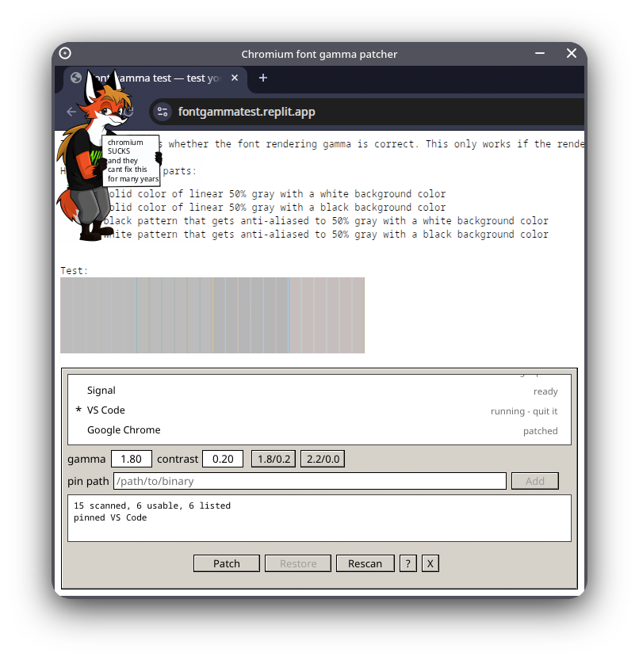

# Chromium gamma patcher

  

Dinky tool to rewrite the font gamma and contrast constants inside a Chromium or Electron executable.

Chromium on Linux returns contrast=0.2 and gamma=1.2 for text in all Electron apps and browsers. This looks utterly horrible and [I hate it a lot](https://forum.vivaldi.net/topic/108982/incorrect-font-rendering-on-linux-wrong-font-gamma-and-contrast-values).

1.8 / 0.2 and 2.2 / 0.0 are better options in my opinion. The former matches Windows, more or less, while the latter is "correct" for the [font gamma test](https://fontgammatest.replit.app), though I found it to be a little thick for my liking.

The patcher directly alters immediates located by their bytes, so anything Chromium should work and only 4 bytes of each are overwritten.

## Build and run

    cargo build --release
    ./target/release/chromium-gamma-patcher          # gui
    ./target/release/chromium-gamma-patcher scan     # target list on stdout

Targets under `/opt` or `/usr` are root-owned. You will need to run the patcher as sudo to patch those, note the `-E` flag to preserve the env:

    sudo -E ./target/release/chromium-gamma-patcher

Headless for scripts:

    sudo -E <binary> patch   /opt/google/chrome/chrome 1.8 0.2
    sudo -E <binary> restore /opt/google/chrome/chrome

## Using it

* the list is the target list; click a row to select it
* click the empty space beside a row to pin it (again to unpin) or:
* type a path into "pin path" for an executable discovery does not know about
* select or type gamma/contrast
* Patch or Restore
* a running program cannot be patched, quit it first

Pinned paths and the patch record are kept in the invoking user's config dir (i.e. `~/.config/chromium-gamma-patcher/`)
Even with sudo it should use your actual user

## What it touches

| file | |
|---|---|
| `<binary>.gamma.bak-<sha12>` | pristine copy, next to binary |
| `~/.config/chromium-gamma-patcher/state.tsv` | pristine and patched hashes plus offsets, so un-patching needs no backup |
| `~/.config/chromium-gamma-patcher/bookmarks.txt` | pinned paths |

The restore feature uses the recorded offsets and checks the result against the pristine hash. A backup is only ever restored when it still carries the signature to prevent a browser update from messing things up

If the patcher is dead for some reason you can always restore the copy on your own by just copying it into the real path.

## Verified

I only verified this on my workstation - x86_64, KDE Plasma 6, Endeavour OS, Vivaldi browser

## AI disclosure

Mostly AI-written, "ported" from my personal patcher script, shouldn't be that sloppy it's simple software

## Thanks

- [egui](https://github.com/emilk/egui)

## License

GPL-3.0 - see [LICENSE](LICENSE) for details.

`assets/xenia_trol.png` is not licensed, see [NOTICE](assets/NOTICE.md).